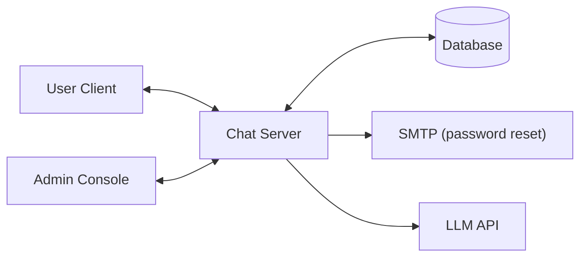
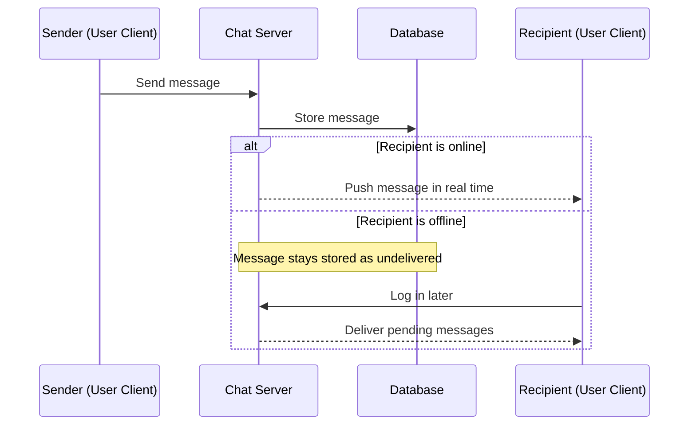

<a id="readme-top"></a>

<div align="center">

# 💬 Java Real-Time Chat System

<p align="center">
  <strong>A modular client-server messaging platform with an administration console, encrypted group chats and AI-assisted writing.</strong>
</p>

<p align="center">
  <em>Final Project, Java Application Programming</em><br/>
  <em>Department of Software Engineering, Faculty of Information Technology, University of Science, VNU-HCM</em>
</p>

<p align="center">
  
  
  
  
  
  
</p>

<p align="center">
  <a href="#project-overview">Overview</a> •
  <a href="#key-features">Features</a> •
  <a href="#tech-stack">Tech Stack</a> •
  <a href="#architecture">Architecture</a> •
  <a href="#repository-structure">Structure</a> •
  <a href="#getting-started">Getting Started</a> •
  <a href="#database-design">Database</a> •
  <a href="#roadmap">Roadmap</a> •
  <a href="#team">Team</a>
</p>

<p align="center">
  <a href="#demo--documentation">Demo Video</a> ·
  <a href="https://github.com/<owner>/<repo>/issues">Report a Bug</a> ·
  <a href="https://github.com/<owner>/<repo>/issues">Request a Feature</a>
</p>

</div>

<!-- Add a short demo GIF here once the app runs, e.g.  -->

---

## Project Overview

Chat System is a real-time communication platform built entirely in Java. It consists of **two desktop applications** that share one database:

1. **Admin Console:** user management, login history, group oversight, spam-report resolution and statistical charts.
2. **User Client:** real-time and offline messaging, friend management, chat search, encrypted group chats and LLM-assisted message suggestions.

<p align="right">(<a href="#readme-top">back to top</a>)</p>

---

## Key Features

The implementation status of every feature is tracked in [ROADMAP.md](ROADMAP.md).

### User Client

- **Authentication & profile:** registration, login, profile and password updates, and password reset with a randomly generated password sent by email.
- **Relationship management:** friend list with live online/offline status; user search by username or name (users who blocked you stay hidden); friend requests (send, accept, decline); unfriend; block (a blocked user cannot send a new request).
- **Messaging:** real-time delivery to online friends and stored delivery for offline ones; full chat history; deletion of a whole conversation or of selected messages; text search inside one conversation or across all of them, with a jump to the matching message.
- **Group chat:** create a group (at least one other member), rename it, add members, grant admin rights and remove members (admins only).
- **Security & moderation:** encrypted group chats and spam reporting.
- **AI assistance:** an LLM refines a draft or suggests a reply.

### Admin Console

- **User oversight:** user list with filters (name, username, status) and sorting (name, creation date); create, update and delete users; lock and unlock accounts; reset passwords; view a user's login history and friend list.
- **Access logs:** chronological login log with time, username and full name.
- **Group management:** group list with sorting (name, creation time) and name filter; members and admins of each group.
- **Spam resolution:** spam reports sorted and filtered by time or username, with the option to lock the reported account.
- **Analytics & data visualization:** new registrations and active users in a chosen date range; friend statistics (direct friends and friends-of-friends) with numeric filters (`=`, `<`, `>`); yearly charts of new registrations and active users per month.

<p align="right">(<a href="#readme-top">back to top</a>)</p>

---

## Tech Stack
<!-- -->

<p align="right">(<a href="#readme-top">back to top</a>)</p>

---

## Architecture

<!-- Update both diagrams to match the final design. -->

**System overview**



**Message delivery flow**



<p align="right">(<a href="#readme-top">back to top</a>)</p>

---

## Repository Structure

The layout follows the submission package.

```text
.
├── src/                      # Source code of both applications and the server
│   ├── admin/                # Admin Console: UI and business logic
│   ├── user/                 # User Client: UI and chat operations
│   ├── server/               # Connection handling and message routing (if applicable)
│   └── common/               # Shared models, DTOs, protocol messages, utilities
├── release/                  # Runnable builds
│   ├── admin.jar
│   ├── user.jar
│   └── config.properties     # Connection settings: edit and run
├── script/
│   └── create_database.sql   # Database creation script
├── git/                      # Screenshots of each member's commits
├── report/                   # Project report
├── docs/                     # README images and diagrams (GitHub only, keep out of the submission archive)
├── .gitignore
├── README.md
└── ROADMAP.md
```

<p align="right">(<a href="#readme-top">back to top</a>)</p>

---

## Getting Started

### Prerequisites

- JDK 17 or later
- A running database server (**TBD**)
- *(Optional)* An SMTP account for password-reset emails
- *(Optional)* An API key for the LLM assistant

### Installation

1. **Clone the repository**
   ```bash
   git clone https://github.com/ladenyx/ChatSystem.git
   cd ChatSystem
   ```

2. **Create the database.** Run the script in `script/` on your database server.
<!-- <Database stack> example:-->
```bash

```


3. **Configure the connection.** Edit `release/config.properties`. The JARs read this file at startup, so no rebuild is needed.
   ```properties
   ```

4. **Run the applications**
   ```bash
   ```

### Build from Source

```bash
# TBD: replace with your actual build command, for example:
# mvn clean package
# ./gradlew build
```

<p align="right">(<a href="#readme-top">back to top</a>)</p>

---

## Usage

**As a user**
1. Launch the User Client and **register** an account, or log in.
2. Search for people by name or username and **send friend requests**.
3. Open a conversation from the friend list or the online-friends list and start chatting.
4. Create a group, add members and chat with encryption.
5. Use the **LLM assistant** in the chat box to polish a draft or get a suggested reply.

**As an administrator**
1. Launch the Admin Console and log in with the admin account (**TBD**; change the default password after the first login).
2. Manage users and groups, and review spam reports.
3. Open the statistics views to explore registrations, friend networks and activity, including the yearly charts.

A complete illustrated guide is available in the [project report](#demo--documentation).

<p align="right">(<a href="#readme-top">back to top</a>)</p>

---

## Database Design

<!-- Keep this section in sync with script/create_database.sql. -->

```mermaid

```
<p align="right">(<a href="#readme-top">back to top</a>)</p>

---

## Security

- **Passwords** are stored as salted hashes (algorithm: **TBD**), never in plain text.
- **Password reset** emails a randomly generated password; users are expected to change it after logging in.
- **Blocking** hides the blocker from the blocked user in search and prevents new friend requests.
- **Encrypted groups:** scheme **TBD** (document the cipher and how keys are distributed).
- **Credentials** for the database, SMTP and LLM live in `release/config.properties` and must not be committed.

<p align="right">(<a href="#readme-top">back to top</a>)</p>

---

## Screenshots

> The UI is under design. These placeholders will be replaced with real screenshots.

<div align="center">
  <table>
    <tr>
      <td align="center" width="50%">
        <strong>User Client: login</strong><br/><br/>
        
      </td>
      <td align="center" width="50%">
        <strong>User Client: chat window</strong><br/><br/>
        
      </td>
    </tr>
    <tr>
      <td align="center" width="50%">
        <strong>Admin Console: user management</strong><br/><br/>
        
      </td>
      <td align="center" width="50%">
        <strong>Admin Console: statistics charts</strong><br/><br/>
        
      </td>
    </tr>
  </table>
</div>

<p align="right">(<a href="#readme-top">back to top</a>)</p>

---

## Roadmap

The project is delivered in two versions. The task-level tracker, with status and owner for every feature, lives in [ROADMAP.md](ROADMAP.md).

| Version | Weight | Scope |
|---------|:------:|-------|
| **Version 1** | 20% | UI screens of both applications and the database creation script |
| **Version 2** | 80% | The complete working system, release package and final report |

Current milestone: **TBD**

<p align="right">(<a href="#readme-top">back to top</a>)</p>

---

## Team

| Member | Student ID | GitHub | Responsibilities | Contribution |
|--------|------------|--------|------------------|:------------:|
| Nguyễn Thế Quân | 24127514 | [@ladenyx](https://github.com/ladenyx) |  | % |
| Nguyễn Phương Gia Bảo | 24127148 | [@baonguyen1776](https://github.com/baonguyen1776) | | % |
| Thái Nguyễn Tuấn Kiệt | 24127597 | [@tkiet24](https://github.com/tkiet24) | | % |
| **Total** | | | | **100 %** |


### Git Workflow

- Every member commits to the shared repository.
- Branch names: `feature/<short-name>`, `fix/<short-name>`.
- Commit messages follow [Conventional Commits](https://www.conventionalcommits.org/): `feat:`, `fix:`, `docs:`, `refactor:`, `chore:`.
- Changes reach `main` through pull requests reviewed by at least one other member.

<p align="right">(<a href="#readme-top">back to top</a>)</p>

---

## Troubleshooting

| Problem | What to check |
|---------|---------------|
| | |

<p align="right">(<a href="#readme-top">back to top</a>)</p>

---

## Demo & Documentation

- 🎥 **Demo video:**
- 📄 **Project report:** `report/`
- 📘 **User guide:** included in the report
- 🗺️ **Roadmap and progress:** [ROADMAP.md](ROADMAP.md)

---

## License

Developed for educational purposes as part of a university course. All rights reserved by the authors unless stated otherwise.

---

<p align="right">(<a href="#readme-top">back to top</a>)</p>
