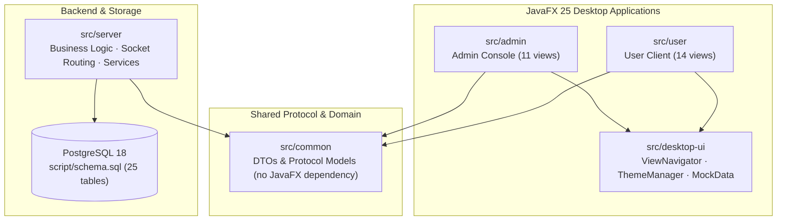

<div align="center">

# WhatsUp (ChatSystem)

**Client/Server Java desktop chat system with end-to-end encrypted group messaging, AI writing assistance, and a graphical administration application.**

[](https://github.com/Ladenyx/ChatSystem/releases/tag/v1.0.0)
[](https://github.com/Ladenyx/ChatSystem/actions/workflows/database.yml)
[-ed8b00?style=flat-square&logo=openjdk&logoColor=white)](https://adoptium.net/)
[](https://openjfx.io/)
[](https://mkpaz.github.io/atlantafx/)
[](https://www.postgresql.org/)
[](https://maven.apache.org/)
[](https://junit.org/junit5/)

[Roadmap](ROADMAP.md) · [Version 1 Report (PDF)](report/report_v1.0.pdf) · [Tech Stack](docs/decisions/tech-stack.md) · [Version 1 Plan](docs/management/plans/version-1-plan.md) · [Screen Specs](docs/requirements/screen.md) · [Release v1.0.0](https://github.com/Ladenyx/ChatSystem/releases/tag/v1.0.0)

</div>

---

## Contents

- [Overview](#overview)
- [Feature overview](#feature-overview)
- [Architecture and module layout](#architecture-and-module-layout)
- [Database design](#database-design)
- [Development requirements](#development-requirements)
- [PostgreSQL setup](#postgresql-setup)
- [Build and test](#build-and-test)
- [Running the desktop applications](#running-the-desktop-applications)
- [Configuration and packaging](#configuration-and-packaging)
- [Team and contributors](#team-and-contributors)
- [Contribution guidelines](#contribution-guidelines)

---

## Overview

**WhatsUp** (`ChatSystem`) is a multi-module Java application built for the course **CSC13102: Java Application Programming** at VNU-HCM University of Science (FIT-HCMUS). The system consists of two JavaFX desktop applications (**User Client** and **Admin Console**) that communicate with a central **Chat Server** backed by **PostgreSQL 18**.

- **Version 1 (20% milestone, completed in [`v1.0.0`](https://github.com/Ladenyx/ChatSystem/releases/tag/v1.0.0))**: delivers all 14 User Client views/dialogs (`U-SCR-01` to `U-SCR-09`, `U-DLG-01` to `U-DLG-05`), all 11 Admin Console views/dialogs (`A-SCR-01` to `A-SCR-09`, `A-DLG-01` to `A-DLG-02`), the shared `desktop-ui` navigation/theme/mock-data engine, 6 editable draw.io ERDs, and a verified PostgreSQL 18 DDL suite ([`script/schema.sql`](script/schema.sql)).
- **Version 2 (80% milestone, planned)**: connects the desktop views to live socket messaging, end-to-end encryption execution, SMTP email verification, LLM inference routing, and externalized fat-JAR packaging in `release/`.

---

## Feature overview

Full requirement status and acceptance criteria are tracked in [ROADMAP.md](ROADMAP.md).

<table>
  <thead>
    <tr>
      <th width="25%">Subsystem</th>
      <th width="20%">Feature IDs</th>
      <th width="55%">Capabilities</th>
    </tr>
  </thead>
  <tbody>
    <tr>
      <td><b>User Client: Authentication and profile</b></td>
      <td><code>U-01</code> to <code>U-05</code><br/><code>U-SCR-01</code> to <code>05</code><br/><code>U-DLG-01</code></td>
      <td>Multi-step registration with per-field validation, 6-digit email OTP verification (10-minute TTL), login, temporary-password recovery (15-minute TTL) with mandatory password update on login, profile editing, and password change.</td>
    </tr>
    <tr>
      <td><b>User Client: Friends and blocking</b></td>
      <td><code>U-06</code> to <code>U-11</code><br/><code>U-SCR-08</code></td>
      <td>Friend list with online/offline presence and name filter, online friends sub-tab with direct chat and group creation shortcuts, incoming/outgoing friend requests, user search (hiding accounts that blocked the caller), unfriend, and blocking.</td>
    </tr>
    <tr>
      <td><b>User Client: Direct and group messaging</b></td>
      <td><code>U-12</code> to <code>U-24</code><br/><code>U-SCR-07</code>, <code>09</code><br/><code>U-DLG-02</code>, <code>05</code></td>
      <td>Real-time and offline message delivery, bottom-aligned conversation timeline with avatars, 48-hour recall for everyone, single and multi-message local deletion, in-conversation search with match jumping, global search across all conversations, group creation, renaming, member addition/removal, admin promotion, and successor handover before leaving.</td>
    </tr>
    <tr>
      <td><b>User Client: E2EE, spam reporting, and AI assistant</b></td>
      <td><code>U-25</code> to <code>U-27</code><br/><code>U-SCR-06</code><br/><code>U-DLG-03</code>, <code>04</code></td>
      <td>End-to-end encrypted group chat (`X25519`/`Ed25519` device keys, 6-digit recovery PIN key backup, epoch group keys), 3-step spam report wizard with evidence selection and submit confirmation, and two compose-bar AI buttons (<b>Refine</b> draft and <b>Recommend</b> reply) powered by up to 50 recent local messages.</td>
    </tr>
    <tr>
      <td><b>Admin Console: Moderation and oversight</b></td>
      <td><code>A-01</code> to <code>A-11</code><br/><code>A-SCR-01</code> to <code>06</code><br/><code>A-DLG-01</code>, <code>02</code></td>
      <td>Dedicated admin login, KPI overview dashboard, split-pane user management (create, edit, lock/unlock, password reset, soft delete/restore, login history tab, friend list tab), group explorer (metadata, admins, and members without exposing E2EE message content), spam report review with evidence context and account lock, and chronological login logs.</td>
    </tr>
    <tr>
      <td><b>Admin Console: Analytics and charts</b></td>
      <td><code>A-12</code> to <code>A-16</code><br/><code>A-SCR-07</code> to <code>09</code></td>
      <td>12-month registration <code>BarChart</code> and date-range registration table, 12-month active-user <code>LineChart</code> and activity table with metric filters (app opens, direct chat peers, groups chatted in using <code>=</code>, <code>&lt;</code>, <code>&gt;</code>), and 12-month friendship chart with direct vs. friends-of-friends network comparison.</td>
    </tr>
  </tbody>
</table>

---

## Architecture and module layout



### Repository structure

```text
ChatSystem/
├── pom.xml                         # Parent POM and dependency management
├── mvnw / mvnw.cmd                 # Maven Wrapper (Maven 3.9.11) for Unix / Windows
├── .mvn/wrapper/                   # Maven Wrapper configuration
├── compose.yaml                    # PostgreSQL 18 container for local development
├── .env.example                    # Local environment template (copy to .env)
├── ROADMAP.md                      # Milestone and feature tracker (U-01..U-27, A-01..A-16)
├── src/
│   ├── common/                     # Shared DTOs and protocol models
│   ├── server/                     # Server business logic, persistence, and integrations
│   ├── desktop-ui/                 # Shared JavaFX navigation, theme engine, and mock fixtures
│   ├── user/                       # User Client JavaFX desktop GUI
│   └── admin/                      # Admin Console JavaFX desktop GUI
├── script/                         # PostgreSQL 18 DDL scripts and automated test suites
├── git/                            # Member commit history screenshots
├── report/                         # Course reports (report_v1.0.pdf)
├── release/                        # Runnable JARs and external config (Version 2)
└── docs/
    ├── architecture/               # Desktop UI guide, mock data guide, Figma links
    ├── databases/                  # SQL workflow and 6 draw.io ERD diagrams
    ├── decisions/                  # Architecture Decision Records (tech stack, E2EE, LLM, spam)
    ├── management/                 # Course specification and Version 1 plan
    └── requirements/               # Screen catalogue and use-case specifications
```

Each Maven module inside `src/` follows the standard layout (`src/main/java/com/chatsystem/<module>/` and `src/test/java/com/chatsystem/<module>/`). In `user` and `admin`, UI assets live under `src/main/resources/com/chatsystem/<module>/` (`fxml/`, `css/`, `images/`) and load via absolute classpath paths such as `/com/chatsystem/user/fxml/<view>.fxml`.

`server`, `user`, and `admin` depend on `common`; `common` has no dependency on JavaFX or server frameworks. `user` and `admin` share `desktop-ui` for scene navigation, modal/drawer/popover management, and theme switching (`Primer Light` and `Primer Dark`). The modules are standard Maven modules without Java Platform Module System descriptors (`module-info.java`).

---

## Database design

The PostgreSQL 18 schema in [`script/schema.sql`](script/schema.sql) orchestrates four domain DDL files inside a single transaction using `\ir`, with `pg_trgm` and `unaccent` enabled for Vietnamese full-text and fuzzy search.

| Domain group | DDL file | Tables | ERD diagram |
|---|---|:---:|---|
| **1. Accounts & authentication** | [`00-core-users.sql`](script/sql/00-core-users.sql), [`10-auth-and-friends.sql`](script/sql/10-auth-and-friends.sql) | 5 | [authentication.drawio.svg](docs/databases/erd/authentication.drawio.svg) |
| **2. Friendships & blocking** | [`10-auth-and-friends.sql`](script/sql/10-auth-and-friends.sql) | 3 | [friends-and-blocks.drawio.svg](docs/databases/erd/friends-and-blocks.drawio.svg) |
| **3. Conversations & messages** | [`20-messaging-e2ee-spam.sql`](script/sql/20-messaging-e2ee-spam.sql) | 4 | [messaging.drawio.svg](docs/databases/erd/messaging.drawio.svg) |
| **4. End-to-end encryption (E2EE)** | [`20-messaging-e2ee-spam.sql`](script/sql/20-messaging-e2ee-spam.sql) | 4 | [e2ee.drawio.svg](docs/databases/erd/e2ee.drawio.svg) |
| **5. Spam reporting & moderation** | [`20-messaging-e2ee-spam.sql`](script/sql/20-messaging-e2ee-spam.sql) | 4 | [spam.drawio.svg](docs/databases/erd/spam.drawio.svg) |
| **6. Login logs & analytics** | [`30-logs-and-analytics.sql`](script/sql/30-logs-and-analytics.sql) | 5 | [logs-and-analytics.drawio.svg](docs/databases/erd/logs-and-analytics.drawio.svg) |
| **Total** | [`script/schema.sql`](script/schema.sql) | **25 tables (158 columns, 36 FKs)** | [SQL workflow](docs/databases/workflow.md) |

The schema passes **381 automated SQL verification checks** (95 Auth/Friends, 156 Messaging/E2EE/Spam, 140 Logs/Analytics, plus concurrent-write probes) on both Docker Compose and native PostgreSQL 18.7 on Windows Server 2025 via [`.github/workflows/database.yml`](.github/workflows/database.yml).

---

## Development requirements

- **Eclipse Temurin JDK 25**: set `JAVA_HOME` to your JDK 25 installation and add `JAVA_HOME/bin` to `PATH`.
- **No separate Maven install required**: the repository includes Maven Wrapper (`mvnw` and `mvnw.cmd`), which downloads **Maven 3.9.11** on first run. Linux and macOS require `curl` or `wget` plus `unzip`; Windows uses PowerShell.
- **IDE setup**: open the root `pom.xml` and set both the Project SDK and Maven Runner JDK to **25**.

Library versions are managed centrally in the parent POM: **JavaFX 25**, **AtlantaFX 2.0.1**, **Ikonli 12.4.0** (Feather icons), and **JUnit Jupiter 5.13.4**. Maven Enforcer verifies JDK 25 and Maven 3.9.x during the `validate` phase.

---

## PostgreSQL setup

Install Docker Engine with Docker Compose on Linux, or Docker Desktop on Windows/macOS.

Copy `.env.example` to `.env` (`cp .env.example .env` on Linux/macOS, `Copy-Item .env.example .env` in PowerShell) and set `POSTGRES_PASSWORD` to a local password. `.env` is ignored by Git.

```sh
docker compose config --quiet
docker compose up -d --wait db
docker compose ps
```

Default connection parameters for local development:

- **Host**: `127.0.0.1`
- **Port**: `55432`
- **Database / User**: `chatsystem`
- **Password**: value of `POSTGRES_PASSWORD` in `.env`

Docker Compose automatically executes the SQL scripts in `script/` when initializing a fresh volume. See [script/README.md](script/README.md) for `psql` usage, logs, and schema reset instructions.

---

## Build and test

Run from the repository root on Linux/macOS:

```sh
./mvnw --version
./mvnw validate
./mvnw clean verify
```

On Windows PowerShell:

```powershell
.\mvnw.cmd --version
.\mvnw.cmd validate
.\mvnw.cmd clean verify
```

Build a single module along with its required dependencies (replace `src/user` with `src/admin` or `src/server` as needed):

```sh
./mvnw -pl src/user -am verify
```

Run unit tests (headless by default; 7 mock-data and time-series tests run without a display):

```sh
./mvnw test
```

Run the full JavaFX GUI test suite (requires a desktop session or `Xvfb` on Linux):

```sh
./mvnw -Pui-tests verify
```

The `ui-tests` profile verifies view navigation, back history, cached page state, session reset, FXML loading, light/dark themes, modals/drawers/popovers, and mock-data bindings. To run the authentication preview suite and export screenshots to `src/user/target/screenshots/`:

```sh
./mvnw -pl src/user -am -Pui-tests -Dtest=AuthPreviewUiIT -Dsurefire.failIfNoSpecifiedTests=false -Dchatsystem.capture=true verify
```

See the [desktop UI testing guide](docs/architecture/desktop-ui.md#kiểm-thử) for details.

---

## Running the desktop applications

Install the shared modules into your local Maven repository before launching for the first time (and after modifying `common` or `desktop-ui`):

```sh
./mvnw install
```

Launch **User Client** and **Admin Console** in separate terminals from the repository root (do not pass `-am` to `javafx:run`):

```sh
./mvnw -pl src/user javafx:run
./mvnw -pl src/admin javafx:run
```

On Windows PowerShell, use `.\mvnw.cmd install`, `.\mvnw.cmd -pl src/user javafx:run`, and `.\mvnw.cmd -pl src/admin javafx:run`.

### Offline preview mode (Version 1)

Both applications currently run **offline against deterministic mock data** (`MockData.create()` in `desktop-ui`: 20 user accounts, 9 conversations with 126 messages, 4 groups, 6 spam reports with evidence windows, 37 login logs, and 12-month statistics for 2025/2026):

- **User Client** opens on the Sign In view (`U-SCR-01`); clicking **Đăng nhập** navigates into the main chat workspace for UI preview without authenticating against a server. Step-transition buttons in Sign Up, Email Verification, and Forgot Password advance through the views without sending emails or mutating persistent accounts.
- Within the User Client workspace, use the left icon rail to switch pages or press **Alt + Left** to go back. The **Cài đặt** menu toggles **Chế độ tối** (`Primer Dark`), opens **Hồ sơ & Bảo mật** (`U-DLG-01`), and opens the mock data preview. Clicking the info button on any conversation opens the right-hand info drawer (`U-SCR-09`).
- **Admin Console** opens directly into the administration shell with sidebar navigation across `A-SCR-01` through `A-SCR-09` and modal dialogs `A-DLG-01` and `A-DLG-02`.

See [ui-mock-data.md](docs/architecture/ui-mock-data.md), [desktop-ui.md](docs/architecture/desktop-ui.md), and [figma_links.md](docs/architecture/figma_links.md) for architecture and design references.

---

## Configuration and packaging

- `script/` holds the PostgreSQL 18 schema, indexes, and verification scripts.
- `release/` is reserved for Version 2 runnable JARs and externalized configuration (`release/config/` is git-ignored; only non-secret templates such as `server.example.properties` are committed).
- Database credentials, SMTP credentials, and LLM API keys belong strictly on the server and must never be bundled into `user` or `admin` client resources.
- Version 1 submission packages contain `src/`, `script/`, `git/`, and the report ([`report/report_v1.0.pdf`](report/report_v1.0.pdf)), along with the parent POM and Maven Wrapper when building from source.

---

## Team and contributors

Course **CSC13102 (24KTPM2)**, supervised by **MSc. Ho Tuan Thanh** and **MSc. Truong Phuoc Loc**.

<table>
  <thead>
    <tr>
      <th align="center">Avatar</th>
      <th>Student ID</th>
      <th>Full name</th>
      <th>GitHub</th>
      <th>Version 1 scope</th>
    </tr>
  </thead>
  <tbody>
    <tr>
      <td align="center"><a href="https://github.com/baonguyen1776"></a></td>
      <td align="center"><code>24127148</code></td>
      <td><b>Nguyen Phuong Gia Bao</b></td>
      <td><a href="https://github.com/baonguyen1776">@baonguyen1776</a></td>
      <td>Auth &amp; profile use cases, Accounts/Friends PostgreSQL DDL &amp; tests, User Client Auth (<code>U-SCR-01</code> to <code>05</code>), E2EE Key Setup (<code>U-SCR-06</code>), Profile &amp; Security (<code>U-DLG-01</code>), Contacts (<code>U-SCR-08</code>), Admin Group Explorer (<code>A-SCR-04</code>), and Spam Moderation (<code>A-SCR-05</code>).</td>
    </tr>
    <tr>
      <td align="center"><a href="https://github.com/Ladenyx"></a></td>
      <td align="center"><code>24127514</code></td>
      <td><b>Nguyen The Quan</b></td>
      <td><a href="https://github.com/Ladenyx">@Ladenyx</a></td>
      <td>Admin use cases &amp; ADRs, Maven multi-module scaffold, shared <code>desktop-ui</code> (<code>ViewNavigator</code>, <code>ThemeManager</code>, <code>MockData</code>), Docker Compose, Messaging/E2EE/Spam PostgreSQL DDL &amp; tests, Admin Sign In (<code>A-SCR-01</code>), Overview (<code>A-SCR-02</code>), User Management (<code>A-SCR-03</code>, <code>A-DLG-01</code>, <code>A-DLG-02</code>), Login Logs (<code>A-SCR-06</code>), and Analytics Dashboards (<code>A-SCR-07</code> to <code>09</code>).</td>
    </tr>
    <tr>
      <td align="center"><a href="https://github.com/tkiet24"></a></td>
      <td align="center"><code>24127597</code></td>
      <td><b>Thai Nguyen Tuan Kiet</b></td>
      <td><a href="https://github.com/tkiet24">@tkiet24</a></td>
      <td>Messaging/Group/AI/Spam use cases, Logs &amp; Analytics PostgreSQL DDL &amp; tests, User Client MainShell &amp; Conversations (<code>U-SCR-07</code>), Conversation Info Drawer &amp; member admin actions (<code>U-SCR-09</code>, <code>U-22</code>, <code>U-23</code>), Group Creation &amp; Successor dialogs (<code>U-DLG-02</code>, <code>U-DLG-05</code>), AI Assistant popover (<code>U-DLG-03</code>), and Spam Report dialog (<code>U-DLG-04</code>).</td>
    </tr>
  </tbody>
</table>

### Repository activity and commit evidence

<div align="center">

[](https://github.com/Ladenyx/ChatSystem/graphs/commit-activity)
[](https://github.com/Ladenyx/ChatSystem/commits/main)
[](https://github.com/Ladenyx/ChatSystem/graphs/contributors)

<a href="https://github.com/Ladenyx/ChatSystem/graphs/contributors">
  
</a>

</div>

Per-member commit screenshots and the team contribution chart are archived in [`git/`](git/) ([`contributors-overview.png`](git/contributors-overview.png)).

---

## Contribution guidelines

- Use branch prefixes `feature/<task-name>`, `fix/<issue-name>`, or `docs/<doc-name>`.
- Format commit messages with **Conventional Commits**, referencing stable roadmap IDs where applicable (for example, `feat(U-16): add single and multi-message deletion` or `docs(U-01): clarify signup rules`).
- Every pull request requires a teammate review and must pass `./mvnw clean verify` (plus `.github/workflows/database.yml` when SQL or Docker Compose files change).
