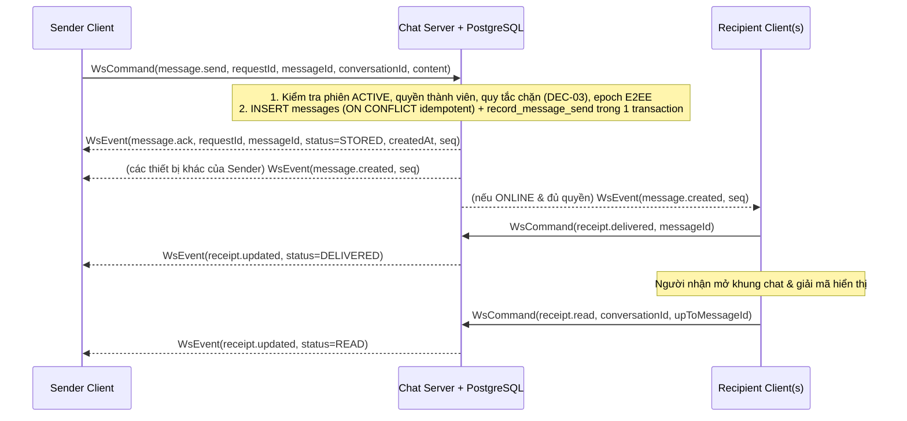

# Đặc tả giao thức WebSocket (Raw JSON over WSS) — ChatSystem

Tài liệu này chốt giao thức WebSocket thời gian thực giữa **User Client** / **Admin App** (dùng `java.net.http.WebSocket` của JDK 25) và **Chat Server** (`Spring Boot 4.1.x` `WebSocketHandler`).

---

## 1. Kết nối và Xác thực Handshake

- **Endpoint duy nhất:** `wss://<host>/ws` (phát triển cục bộ: `ws://127.0.0.1:8080/ws`).
- **Xác thực qua HTTP Upgrade headers** (không truyền token trên query string để tránh lộ vào access log):
  - `Authorization: Bearer <opaque-session-token>` *(bắt buộc)*
  - `X-Client-Device-Id: <uuid>` *(tùy chọn cho `USER_CLIENT` đã đăng ký `e2ee_devices`)*
- **Kiểm tra trước khi nâng cấp kết nối:**
  - Token không hợp lệ hoặc đã thu hồi → từ chối nâng cấp bằng HTTP `401 Unauthorized`.
  - Tài khoản `LOCKED` / `DELETED` hoặc chưa xác minh email → từ chối nâng cấp bằng HTTP `403 Forbidden`.
  - Server tự suy ra `userId`, `sessionId`, `role` và `scope` (`USER_CLIENT` hoặc `ADMIN_APP`) từ bảng `user_sessions`.
- **Giới hạn phiên Admin App:**
  - Nếu một phiên `ADMIN_APP` mới đăng nhập hợp lệ, Server lập tức đẩy `session.revoked` (`reason = ADMIN_NEW_LOGIN`) tới kết nối WSS cũ và đóng bằng mã `4004`. Reconnect dùng token cũ sẽ bị từ chối ở bước handshake (`401`).

---

## 2. Cấu trúc khung JSON (Frame Envelopes)

Toàn bộ bản tin là khung **Text UTF-8 JSON**, đặt tên trường theo `camelCase`. Mô hình Java nằm tại `com.chatsystem.common.ws`.

### 2.1. Client → Server (`WsCommand<T>`)

```json
{
  "type": "message.send",
  "requestId": "7a8b9c0d-1111-4222-8333-444455556666",
  "timestamp": "2026-11-15T03:00:01Z",
  "payload": {
    "messageId": "11111111-2222-4333-8444-555555555555",
    "conversationId": "aaaaaaaa-bbbb-4ccc-8ddd-eeeeeeeeeeee",
    "contentPlain": "Chào bạn, mình vừa gửi bản kế hoạch."
  }
}
```

- `type` *(string, bắt buộc)*: tên lệnh chuẩn trong `WsEventType`.
- `requestId` *(UUID, bắt buộc)*: do Client sinh để đối chiếu phản hồi `message.ack` / `system.ack` / `system.error`.
- `timestamp` *(Instant UTC, bắt buộc)*: thời điểm Client tạo lệnh (chỉ để chẩn đoán; Server luôn dùng đồng hồ Server làm nguồn chân lý).
- `payload` *(object, bắt buộc)*: nội dung cụ thể của từng lệnh (`{}` nếu lệnh không có tham số).

### 2.2. Server → Client (`WsEvent<T>`)

```json
{
  "type": "message.created",
  "eventId": "f1e2d3c4-5555-4666-8777-888899990000",
  "seq": 1042,
  "requestId": null,
  "timestamp": "2026-11-15T03:00:01.120Z",
  "payload": { ... }
}
```

- `type` *(string, bắt buộc)*: tên sự kiện trong `WsEventType`.
- `eventId` *(UUID, bắt buộc)*: định danh duy nhất của sự kiện để Client chống xử lý trùng.
- `seq` *(long, nullable)*: số thứ tự tăng nghiêm ngặt trên luồng đồng bộ của từng `userId` đối với các sự kiện bền vững cần đồng bộ bù; bằng `null` với các khung điều khiển tạm thời (`system.connected`, `system.pong`, `system.error`, `presence.changed`, `presence.snapshot`).
- `requestId` *(UUID, nullable)*: sao chép từ `WsCommand.requestId` khi đây là phản hồi trực tiếp cho một lệnh của Client (`message.ack`, `system.ack`, `system.error`); bằng `null` với sự kiện push.
- `timestamp` *(Instant UTC, bắt buộc)*: thời điểm Server phát sự kiện.
- `payload` *(object, bắt buộc)*: dữ liệu sự kiện (với `system.error`, `payload` tuân theo cấu trúc `ApiError`).

---

## 3. Vòng đời kết nối, Heartbeat và Presence

1. **Khởi tạo (`system.connected`):** Ngay sau khi nâng cấp WSS thành công, Server gửi `system.connected` chứa:
   ```json
   {
     "sessionId": "...",
     "userId": "...",
     "scope": "USER_CLIENT",
     "latestSeq": 1041,
     "serverTime": "2026-11-15T03:00:00Z",
     "heartbeatIntervalSec": 25
   }
   ```
2. **Heartbeat:** Client gửi `system.ping` mỗi `heartbeatIntervalSec` giây (mặc định **25 giây**); Server đáp `system.pong` ngay kèm `serverTime`. Nếu Server không nhận khung nào trong **60 giây**, Server đóng kết nối bằng mã `4008`.
3. **Presence (`ONLINE` / `OFFLINE`):**
   - Lưu trong bộ nhớ Server (`ConcurrentHashMap<UUID, Set<WebSocketSession>>`) chỉ tính các kết nối có `scope == USER_CLIENT`. Kết nối `ADMIN_APP` **không** làm tài khoản xuất hiện `ONLINE` trên danh sách bạn bè.
   - Tài khoản chuyển sang `ONLINE` khi số kết nối `USER_CLIENT` tăng từ `0 → 1`.
   - Khi số kết nối giảm từ `1 → 0`, Server chờ cửa sổ trễ **10 giây** (grace period) trước khi phát `presence.changed (OFFLINE)` để tránh nhấp nháy khi rớt mạng ngắn.
   - **Phạm vi người nhận `presence.changed`:** chỉ phát cho những tài khoản đang `ONLINE` có quan hệ **bạn bè** hoặc cùng hội thoại 1-1 hoạt động và **không có quan hệ chặn hai chiều** ([DEC-03](../../decisions/blocking-and-friendship.md)). Không phát broadcast toàn hệ thống.
   - Ngay sau `system.connected` trên `USER_CLIENT`, Server gửi `presence.snapshot` chứa danh sách `onlineUserIds` trong phạm vi bạn bè/liên hệ hiện tại của người dùng.

---

## 4. Gửi tin, ACK, Retry an toàn và Biên nhận (`DELIVERED` / `READ`)

### 4.1. Luồng gửi tin bền vững (`message.send` → `message.ack`)



- **Quy tắc chống mất/trùng tin ([DEC-02](../../decisions/message-deletion.md), [DEC-09](../../decisions/performance-and-acceptance.md)):**
  - Server **chỉ** gửi `message.ack` sau khi transaction PostgreSQL (`messages` + `record_message_send`) đã commit.
  - Nếu kết nối đứt trước khi Client nhận `message.ack`, Client giữ tin ở trạng thái `PENDING` (hoặc `FAILED` sau khi hết lượt thử tự động) và gửi lại `message.send` (hoặc `POST /api/v1/conversations/{id}/messages`) với **đúng `messageId` ban đầu**.
  - Khi nhận lại `messageId` đã tồn tại cùng người gửi, cùng hội thoại và cùng nội dung, Server trả `message.ack` với `createdAt` gốc và **không** phát sinh tin thứ hai hay lượt thống kê thứ hai. Nếu cùng `messageId` nhưng khác hội thoại/nội dung, Server trả `system.error` với mã `IDEMPOTENCY_CONFLICT` (`retryable = false`).
- **Thứ tự hiển thị:** Nguồn sắp xếp chuẩn của hội thoại là `(createdAt ASC, id ASC)` theo thời gian Server ghi nhận. Khi nhận `message.ack`, Client cập nhật `createdAt` chính thức từ Server.
- **Biên nhận không lùi trạng thái (`UC-USR-MSG-01` NFR-01, BR-02):**
  - Thứ tự đơn điệu theo từng người nhận: `STORED` → `DELIVERED` → `READ`.
  - Client chỉ gửi `receipt.read` sau khi tin đã được hiển thị (và đã giải mã thành công nếu là nhóm E2EE).

---

## 5. Đồng bộ bù sau khi kết nối lại (Reconnect Catch-up)

- Client lưu `lastAckedSeq` cục bộ (tăng dần sau khi xử lý xong mỗi `WsEvent` có `seq != null`).
- Khi kết nối lại thành công và nhận `system.connected (latestSeq)`:
  1. Nếu `lastAckedSeq == latestSeq`: không cần đồng bộ bù.
  2. Nếu `lastAckedSeq < latestSeq`: Client gửi `sync.resume { lastAckedSeq, limit: 200 }` (hoặc gọi `GET /api/v1/sync/events?afterSeq=<lastAckedSeq>&limit=200`).
  3. Server trả `sync.batch { events, nextSeq, latestSeq, hasMore, fullResyncRequired }` theo thứ tự `seq` tăng dần, đã kiểm tra lại quyền truy cập hiện tại (ví dụ: không gửi sự kiện tin mới của nhóm mà người dùng đã bị xóa khỏi nhóm, nhưng vẫn gửi sự kiện `group.members_changed` thông báo bị xóa).
  4. Nếu `hasMore == true`, Client tiếp tục kéo trang tiếp theo bằng `nextSeq`.
  5. Nếu `fullResyncRequired == true` (đứt kết nối quá cửa sổ giữ log sự kiện hoặc lần đăng nhập đầu trên thiết bị mới), Client tải lại danh sách hội thoại (`GET /api/v1/conversations`) và lịch sử các hội thoại đang mở qua REST.
- Các sự kiện thời gian thực đến mới trong lúc đang `sync.resume` được Client đệm tạm và loại trùng bằng `eventId` / `seq` sau khi ghép xong.
- **Backoff kết nối lại phía Client:** exponential backoff có jitter (`1s → 2s → 4s → 8s → tối đa 30s`), dừng ngay khi nhận mã đóng `4001`–`4004` (lỗi phiên/tài khoản bị thu hồi) để chuyển về màn hình đăng nhập.

---

## 6. Danh mục sự kiện & Phạm vi người nhận

### 6.1. Lệnh Client → Server (`WsCommand`)

| `type` | Scope | Payload chính | Phản hồi trực tiếp |
| --- | --- | --- | --- |
| `system.ping` | `USER_CLIENT`, `ADMIN_APP` | `{}` | `system.pong` |
| `sync.resume` | `USER_CLIENT` | `{ lastAckedSeq, limit }` | `sync.batch` |
| `message.send` | `USER_CLIENT` | `{ messageId, conversationId, contentPlain?, contentCipher?, cryptoMetadata? }` | `message.ack` hoặc `system.error` |
| `receipt.delivered` | `USER_CLIENT` | `{ conversationId, messageIds }` | `system.ack` |
| `receipt.read` | `USER_CLIENT` | `{ conversationId, upToMessageId }` | `system.ack` |

*(Các thao tác quản lý tài nguyên như tạo nhóm, đổi tên, thêm/xóa thành viên, kết bạn, chặn, thu hồi/xóa tin, gửi báo cáo spam, gọi AI và toàn bộ thao tác Admin đều đi qua **HTTPS REST** để dễ validate, áp dụng idempotency và tách biệt trách nhiệm; Server sau khi commit DB sẽ đẩy sự kiện thời gian thực tương ứng qua WSS.)*

### 6.2. Sự kiện Server → Client (`WsEvent`)

| `type` | Có `seq`? | Phạm vi người nhận & kiểm tra quyền trước khi phát |
| --- | :---: | --- |
| `system.connected` | Không | Kết nối vừa thiết lập |
| `system.pong` | Không | Kết nối gửi `system.ping` |
| `system.ack` | Không | Kết nối gửi lệnh thành công (khớp `requestId`) |
| `system.error` | Không | Kết nối gửi lệnh thất bại (payload là `ApiError`, khớp `requestId`) |
| `session.revoked` | Không | Các kết nối thuộc phiên bị thu hồi (kèm `reason`, đóng WSS ngay sau đó) |
| `sync.batch` | Không | Kết nối yêu cầu `sync.resume` |
| `presence.snapshot` | Không | Phiên `USER_CLIENT` mới kết nối (chỉ bạn bè/liên hệ không chặn) |
| `presence.changed` | Không | Bạn bè / đối phương chat 1-1 đang online và không có quan hệ chặn hai chiều |
| `message.ack` | Có | Kết nối gửi `message.send` (khớp `requestId`) |
| `message.created` | Có | Thành viên còn quyền đọc của hội thoại (với 1-1: cả hai phía nếu chưa chặn tại thời điểm chấp nhận tin; với nhóm: chỉ thành viên `left_at IS NULL`) và các thiết bị khác của người gửi |
| `message.recalled` | Có | Thành viên còn quyền xem lịch sử hội thoại (để cập nhật nhãn thu hồi & xóa nội dung khỏi bộ nhớ tìm kiếm local) |
| `message.deleted_for_self` | Có | Các thiết bị `USER_CLIENT` khác của **chính người thực hiện** (đồng bộ trạng thái xóa phía mình theo DEC-02) |
| `conversation.cleared` | Có | Các thiết bị `USER_CLIENT` khác của **chính người thực hiện** (`U-15`) |
| `receipt.updated` | Có | Người gửi tin (và các thiết bị khác của người nhận để đồng bộ `unreadCount`) |
| `friend_request.created` | Có | Người nhận lời mời & các thiết bị khác của người gửi |
| `friend_request.updated` | Có | Hai bên liên quan (`ACCEPTED`, `REJECTED`, `CANCELLED`) |
| `friendship.created` | Có | Hai người bạn mới |
| `friendship.removed` | Có | Hai bên liên quan |
| `block.updated` | Có | Các thiết bị của người chặn; phía bị chặn nhận tín hiệu vô hiệu hóa thanh soạn tin 1-1 (không lộ thông tin nhạy cảm ngoài trạng thái chặn giao tiếp) |
| `group.created` | Có | Các thành viên trong nhóm mới |
| `group.renamed` | Có | Thành viên hiện tại của nhóm |
| `group.members_changed` | Có | Thành viên hiện tại của nhóm và người vừa bị xóa/rời nhóm (để đóng quyền gửi tin mới ngay lập tức) |
| `group.role_updated` | Có | Thành viên hiện tại của nhóm |
| `group.closed` | Có | Thành viên liên quan của nhóm đã đóng |
| `e2ee.device_trust_requested` | Có | Các thiết bị đã tin cậy (`trusted_at IS NOT NULL AND revoked_at IS NULL`) cùng `userId` |
| `e2ee.device_trusted` | Có | Thiết bị mới vừa được xác nhận & các thiết bị khác cùng `userId` |
| `e2ee.device_revoked` | Có | Thiết bị bị thu hồi & các thiết bị khác cùng `userId` |
| `e2ee.group_epoch_rotated` | Có | Thiết bị tin cậy của thành viên hiện tại trong nhóm (người đã rời/bị xóa tuyệt đối không nhận) |
| `e2ee.key_envelope_available` | Có | Đích thiết bị `recipient_device_id` cụ thể thuộc thành viên được phép |
| `admin.kpi.updated` | Không | Phiên `ADMIN_APP` đang mở (`A-SCR-02`: số người online, tổng user/nhóm, spam chờ xử lý) |
| `admin.spam_report.created` | Không | Phiên `ADMIN_APP` đang mở (chỉ metadata danh sách, không đẩy bản rõ bằng chứng trừ khi Admin mở chi tiết) |
| `admin.spam_report.reviewed` | Không | Phiên `ADMIN_APP` đang mở |
| `admin.user.status_changed` | Không | Phiên `ADMIN_APP` đang mở |

> **Kiểm tra quyền trước khi phát (Double-check on fan-out):** Trước khi ghi khung vào từng socket đích, Server phải kiểm tra lại trạng thái phiên chưa bị thu hồi và tư cách thành viên/phạm vi hiện tại — không dựa vào danh sách phòng lưu đệm cũ sau khi người dùng đã bị xóa khỏi nhóm hoặc bị khóa tài khoản.

---

## 7. Mã đóng kết nối WebSocket (`WsCloseCode`)

| Mã | Tên (`WsCloseCode`) | Ý nghĩa | Hành vi phía Client |
| :---: | --- | --- | --- |
| `1000` | `NORMAL_CLOSURE` | Đóng kết nối bình thường (đăng xuất / thoát ứng dụng) | Không reconnect |
| `4001` | `UNAUTHORIZED` | Token không hợp lệ hoặc thiếu xác thực | Xóa phiên local, về màn hình đăng nhập |
| `4002` | `SESSION_REVOKED` | Phiên bị thu hồi (đổi mật khẩu / thu hồi phiên) | Hiển thị lý do, `navigator.reset(...)` về đăng nhập |
| `4003` | `ACCOUNT_RESTRICTED` | Tài khoản bị khóa (`LOCKED`) hoặc xóa mềm (`DELETED`) | Hiển thị thông báo trạng thái tài khoản, về đăng nhập |
| `4004` | `ADMIN_SESSION_REPLACED` | Phiên Admin App bị thay thế bởi lần đăng nhập mới | Hiển thị thông báo phiên quản trị đã đăng nhập ở nơi khác, về `A-SCR-01` |
| `4008` | `HEARTBEAT_TIMEOUT` | Quá hạn heartbeat 60 giây | Reconnect theo exponential backoff + `sync.resume` |
| `4009` | `RESYNC_REQUIRED` | Buffer sự kiện quá tải hoặc trạng thái kết nối lệch | Reconnect + đồng bộ lại qua REST |
