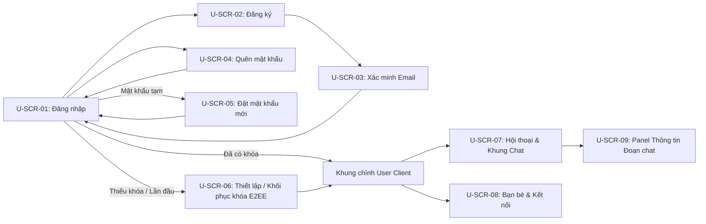
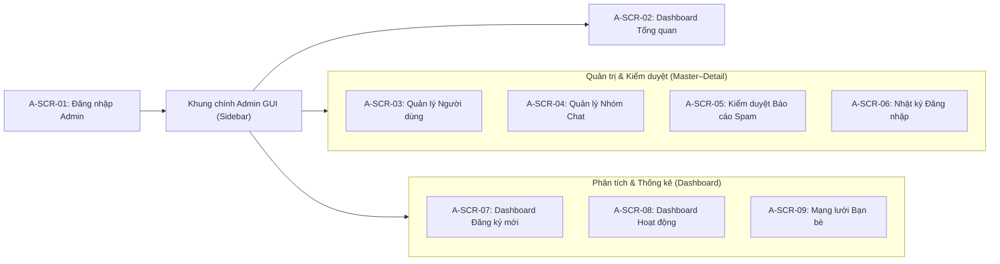

# Danh sách Màn hình & Ánh xạ Chức năng (Screen Map)

Tài liệu đặc tả danh sách màn hình, khung trượt (Drawer) và hộp thoại (Modal/Popover) cho hai ứng dụng Desktop giao diện đồ họa JavaFX: **User Client** (`user.jar`) và **Admin App** (`admin.jar`).

---

## Sơ đồ điều hướng tổng quan

### 1. User Client (`user.jar`)

### 2. Admin App (`admin.jar`)

---

## Phần 1. Phân hệ Người sử dụng — `User Client`

### 1.1. Cụm màn hình Xác thực & Khởi tạo (`Auth & Onboarding`)

| Mã | Tên màn hình | Feature ID | Thành phần & Chức năng chính |
| :--- | :--- | :--- | :--- |
| `U-SCR-01` | **Đăng nhập (`Sign In View`)** | `U-02` | - Nhập `username`, `password`, nút **Sign in** - Điều hướng sang **Đăng ký** (`U-SCR-02`) và **Quên mật khẩu** (`U-SCR-04`) - Hiển thị thông báo lỗi xác thực, tài khoản bị khóa, hoặc phiên cũ bị thu hồi khi đăng nhập ở thiết bị khác (1 phiên/tài khoản) |
| `U-SCR-02` | **Đăng ký (`Sign Up View`)** | `U-01` | - Nhập các trường bắt buộc (*`username`*, *`password`*, *`confirm password`*, *`họ tên`*, *`email`*) và tùy chọn (`địa chỉ`, `ngày sinh`, `giới tính`) - Hiển thị lỗi kiểm tra hợp lệ tại từng trường; liên kết quay lại **Đăng nhập** |
| `U-SCR-03` | **Xác minh Email (`Email Verification View`)** | `U-01`, `U-03` | - Nhập mã xác minh gửi qua email sau khi đăng ký mới hoặc khi đổi sang địa chỉ email mới - Hỗ trợ gửi lại mã (có đếm ngược giãn cách) và quay về màn hình Đăng nhập |
| `U-SCR-04` | **Quên mật khẩu (`Forgot Password View`)** | `U-05` | - Nhập `username` / `email` để yêu cầu gửi mật khẩu tạm ngẫu nhiên qua email (hiệu lực **15 phút**) - Hiển thị bộ đếm giãn cách gửi lại (**60 giây**, tối đa 5 yêu cầu/giờ/tài khoản) |
| `U-SCR-05` | **Đặt mật khẩu bắt buộc (`Force Change Password View`)** | `U-05`, `A-02`, `A-04` | - Hiển thị khi người dùng đăng nhập bằng **mật khẩu tạm** (sau khôi phục mật khẩu, Admin reset, hoặc tài khoản do Admin mới tạo); chưa cho phép vào khung chat chính - Sau khi đặt mật khẩu mới thành công, thu hồi phiên tạm và chuyển về `U-SCR-01` để đăng nhập lại |
| `U-SCR-06` | **Thiết lập / Khôi phục khóa E2EE (`E2EE Key Setup & Recovery View`)** | `U-25` | - **Thiết lập lần đầu**: sinh khóa thiết bị và hiển thị **Mã khôi phục (Recovery Code)** để người dùng lưu trữ - **Đăng nhập trên máy mới**: nhập Mã khôi phục để giải mã bản sao lưu khóa, kèm thanh tiến độ đồng bộ lịch sử chat |

### 1.2. Khung làm việc chính (`Main Workspace Shell`)

Sử dụng thanh điều hướng dọc (Icon Rail) bên trái cùng gồm: chuyển sang **Đoạn chat** (`U-SCR-07`), chuyển sang **Bạn bè & Kết nối** (`U-SCR-08`), mở **Hồ sơ & Bảo mật** (`U-DLG-01`) và **Đăng xuất**.

| Mã | Tên không gian / Panel | Feature ID | Thành phần & Chức năng chính |
| :--- | :--- | :--- | :--- |
| `U-SCR-07` | **Hội thoại & Khung Chat (`Conversations & Chat View`)** | `U-12` → `U-16`, `U-18`, `U-19`, `U-24`, `U-25`, `U-27` | **Cột trái — Danh sách đoạn chat & Tìm kiếm tổng hợp**: - Header cột trái có nút **Tạo nhóm mới** (`U-19` → mở `U-DLG-02`) - **Ô tìm kiếm phía trên danh sách đoạn chat**: khi nhập từ khóa sẽ trả về 2 nhóm kết quả gồm *Đoạn chat khớp tên* (người dùng/nhóm) và *Tin nhắn khớp nội dung trên tất cả hội thoại* (`U-18`, bấm vào sẽ mở đoạn chat và nhảy tới dòng tin tương ứng; có báo trạng thái nếu lịch sử đang đồng bộ) - Bộ lọc nhanh (*Tất cả*, *Chưa đọc*, *Nhóm*) và danh sách đoạn chat 1-1 / Nhóm E2EE (kèm trạng thái Online/Offline)  **Khung giữa — Luồng tin nhắn & Thanh soạn thảo**: - Header: avatar, tên người/nhóm, trạng thái Online hoặc nhãn E2EE, nút **`i`** bật/tắt Panel thông tin bên phải (`U-SCR-09`) - Vùng lịch sử chat (`U-14`): phân trang **50 tin/trang**, banner tiến độ đồng bộ, tự cuộn & highlight tin nhắn đích khi nhảy từ tìm kiếm (`U-17`, `U-18`), hiển thị trạng thái gửi (*Đang chờ/Thử lại*, *Server đã lưu*, *Đã nhận/Đã đọc*) - Thao tác trên tin nhắn (`U-16`): **Xóa phía mình** (hỗ trợ xóa 1 hoặc chọn nhiều dòng) và **Thu hồi với mọi người** (chỉ áp dụng cho tin của chính mình trong **48 giờ** đầu) - Thanh soạn tin (`U-12`, `U-13`, `U-24`, `U-27`): ô nhập văn bản, **2 nút AI độc lập** gồm **nút Chỉnh sửa (`Refine`)** và **nút Gợi ý (`Recommend`)** (mở `U-DLG-03`), cùng nút Gửi; tự vô hiệu hóa ô nhập kèm thông báo nếu hai bên đang chặn nhau |
| `U-SCR-08` | **Bạn bè & Kết nối (`Contacts & People View`)** | `U-06` → `U-11`, `U-19` | Gồm 5 phân mục (sub-tab): 1. **Tất cả bạn bè (`U-06`, `U-09`, `U-10`)**: lọc theo tên, hiển thị trạng thái Online/Offline, nút *Nhắn tin*, *Hủy kết bạn*, *Chặn* 2. **Đang Online (`U-11`)**: lọc bạn bè đang trực tuyến theo tên, nút *Nhắn tin* hoặc *Tạo nhóm* (`U-DLG-02`) 3. **Lời mời kết bạn (`U-08`)**: lọc theo tên, nút *Đồng ý* / *Từ chối* 4. **Tìm người dùng (`U-07`)**: tìm theo `username` hoặc `họ tên` (ẩn người đang chặn mình); cho phép *Kết bạn*, *Nhắn tin riêng* (kể cả khi chưa kết bạn) hoặc *Tạo nhóm* (với bạn bè) 5. **Đã chặn (`Blocked Users`)**: danh sách tài khoản đã chặn và nút *Bỏ chặn* (không tự khôi phục quan hệ bạn bè cũ) |
| `U-SCR-09` | **Panel Thông tin Đoạn chat (`Conversation / Group Drawer`)** | `U-10`, `U-15`, `U-17`, `U-20` → `U-23`, `U-25`, `U-26` | **Đầu Panel (dùng chung cho Chat 1-1 & Nhóm)**: - Avatar lớn, tên người/nhóm, trạng thái Online hoặc chỉ báo E2EE - **Nút tròn `Tìm kiếm` (`U-17`)**: mở khung tìm chuỗi tin nhắn **trong riêng đoạn chat hiện tại**, liệt kê kết quả / điều hướng Lên–Xuống để nhảy tới đúng đoạn tin ở khung giữa  **Mục mở rộng khi mở Chat 1-1**: - *Quyền riêng tư & hỗ trợ*: *Xóa toàn bộ lịch sử phía mình* (`U-15`), *Báo cáo spam* (`U-DLG-04`), *Chặn người dùng* (`U-10`)  **Mục mở rộng khi mở Nhóm Chat E2EE**: - *Tùy chỉnh nhóm*: Đổi tên nhóm (`U-20` — chỉ Admin nhóm) - *Thành viên nhóm*: nút *Thêm thành viên* (`U-21` — mời bạn bè không có quan hệ chặn); danh sách thành viên kèm nhãn `Admin`, menu cho Admin gồm *Cấp/Thu hồi quyền Admin* (`U-22`) và *Xóa thành viên* (`U-23`) - *Quyền riêng tư & hỗ trợ*: thông tin mã hóa E2EE (`U-25`), *Xóa toàn bộ lịch sử phía mình* (`U-15`), *Báo cáo spam* (`U-DLG-04`), *Rời nhóm* |

### 1.3. Các Hộp thoại & Popover của `User Client`

| Mã | Tên hộp thoại / Popover | Feature ID | Chức năng & Ràng buộc giao diện |
| :--- | :--- | :--- | :--- |
| `U-DLG-01` | **Hồ sơ & Bảo mật Tài khoản (`Profile & Security Dialog`)** | `U-03`, `U-04`, `U-25` | - **Tab Hồ sơ (`U-03`)**: hiển thị `username` (chỉ đọc), cập nhật `họ tên`, `địa chỉ`, `ngày sinh`, `giới tính`; đổi `email` yêu cầu mật khẩu hiện tại và xác minh email mới (`U-SCR-03`) - **Tab Đổi mật khẩu (`U-04`)**: nhập mật khẩu hiện tại, mật khẩu mới và xác nhận mật khẩu mới - **Tab Khóa E2EE (`U-25`)**: kiểm tra trạng thái sao lưu khóa và tạo lại mã khôi phục |
| `U-DLG-02` | **Tạo nhóm chat mới (`Create Group Dialog`)** | `U-19`, `U-25` | - Nhập tên nhóm, tìm và chọn **tối thiểu 1 thành viên** từ danh sách bạn bè (không có quan hệ chặn hai chiều) - Nhóm tạo mới mặc định bật E2EE; người tạo là Admin đầu tiên |
| `U-DLG-03` | **Popover Trợ lý AI (`LLM Refine & Recommend Popover`)** | `U-27` | Mở tương ứng từ **2 nút riêng biệt** trên thanh soạn tin: 1. **Chế độ Chỉnh sửa (`Refine Draft`)**: nhận nội dung đang gõ ở ô soạn thảo (kích hoạt khi ô nháp có chữ), chọn kiểu diễn đạt mong muốn và sinh các phương án viết lại 2. **Chế độ Gợi ý (`Recommend Reply`)**: cho phép chọn các tin nhắn ngữ cảnh trong hội thoại để sinh danh sách câu trả lời gợi ý  **Quy tắc chung**: có bước **xem trước & xác nhận** gửi bản rõ tới Server và nhà cung cấp AI (kể cả trong nhóm E2EE); kết quả chọn chỉ điền vào **ô soạn nháp** để người dùng tự kiểm tra trước khi gửi (lỗi/hết hạn mức vẫn giữ nguyên nháp cũ) |
| `U-DLG-04` | **Báo cáo Spam (`Report Spam Dialog`)** | `U-26` | - Chọn một hoặc nhiều tin nhắn vi phạm kèm lý do báo cáo - Có bước **xem trước & xác nhận** gửi bản rõ tin nhắn cho Admin hệ thống (kể cả từ nhóm E2EE) |
| `U-DLG-05` | **Chọn Admin kế nhiệm (`Assign Successor Admin Dialog`)** | `U-22` | - Bắt buộc hiển thị khi **Admin duy nhất còn lại** của nhóm muốn hạ quyền hoặc rời nhóm khi nhóm vẫn còn thành viên khác |

---

## Phần 2. Phân hệ Người quản trị — `Admin App` (Desktop GUI)

> **Chuẩn giao diện `Admin App`**:
> - Tổ chức theo khung ứng dụng Desktop hiện đại với **Sidebar phân nhóm**, trang chủ **Dashboard Tổng quan**, bố cục chia đôi **`Master–Detail` (`SplitPane`)** để xem chi tiết trực tiếp bên phải thay vì bật nhiều cửa sổ con, và các trang **Dashboard Thống kê** tích hợp biểu đồ tương tác (`BarChart` / `LineChart`) cùng bảng lọc dữ liệu.
> - Mọi mốc thời gian hiển thị và bộ lọc ngày đều tính theo múi giờ `Asia/Ho_Chi_Minh`.

### 2.1. Xác thực, Trang chủ & Nhóm Quản trị – Kiểm duyệt

| Mã | Tên màn hình | Feature ID | Bố cục & Tương tác đồ họa chính |
| :--- | :--- | :--- | :--- |
| `A-SCR-01` | **Đăng nhập Quản trị (`Admin Sign In View`)** | — | - Màn hình đăng nhập dành cho tài khoản Admin hệ thống (khởi tạo từ server, giới hạn 1 phiên hoạt động mỗi tài khoản) |
| `A-SCR-02` | **Dashboard Tổng quan (`Admin Overview Dashboard`)** | Tổng quan | - Trang chủ mở ra ngay sau khi đăng nhập - **4 Thẻ KPI**: *Tổng người dùng*, *Đang Online*, *Tổng nhóm chat*, *Báo cáo Spam chờ xử lý* (bấm vào từng thẻ để mở nhanh màn hình quản trị tương ứng) - **Khối tóm tắt trực quan**: biểu đồ xu hướng nhanh trong năm hiện tại kèm danh sách rút gọn *Báo cáo spam mới nhất* và *Lượt đăng nhập gần đây* |
| `A-SCR-03` | **Quản lý Người dùng (`User Management Split View`)** | `A-01` → `A-06` | **Khung trái — Danh sách & Bộ lọc (`A-01`)**: - Tìm kiếm theo `họ tên` / `username` + dãy **Status Chips** (*Tất cả*, *Hoạt động*, *Bị khóa*, *Chờ xác minh*, *Xóa mềm 30 ngày*); bấm tiêu đề cột để sắp xếp theo `họ tên` hoặc `ngày tạo`; nút **+ Thêm User** (mở `A-DLG-01`)  **Khung phải — User Inspector cố định (`A-02` → `A-06`)**: - Hiển thị thẻ hồ sơ đầy đủ (`username`, `họ tên`, `địa chỉ`, `ngày sinh`, `giới tính`, `email`), trạng thái và cụm nút thao tác: *Sửa hồ sơ* (`A-DLG-01`), *Khóa / Mở khóa* (`A-03` — thu hồi phiên ngay), *Reset mật khẩu qua email* (`A-04`), *Xóa mềm 30 ngày / Khôi phục trước hạn* (`A-02`) - Tích hợp sẵn **2 Tab chi tiết** ngay bên dưới: **Lịch sử đăng nhập (`A-05`)** và **Danh sách bạn bè (`A-06`)** |
| `A-SCR-04` | **Quản lý Nhóm Chat (`Group Explorer Split View`)** | `A-08`, `A-09` | **Khung trái — Danh sách nhóm (`A-08`)**: - Lọc theo `tên nhóm`, sắp xếp theo `tên nhóm` hoặc `thời gian tạo`, hiển thị quy mô thành viên  **Khung phải — Chi tiết thành viên (`A-09`)**: - Tách trực quan danh sách **Admin nhóm** (gắn nhãn nổi bật ở trên) và danh sách **Thành viên nhóm** (ở dưới); không hiển thị nội dung tin nhắn do nhóm mã hóa E2EE |
| `A-SCR-05` | **Kiểm duyệt Báo cáo Spam (`Spam Moderation Split View`)** | `A-10`, `A-11` | **Khung trái — Danh sách báo cáo (`A-10`)**: - Lọc theo khoảng thời gian (`DatePicker`) và `username`; sắp xếp theo `thời gian` hoặc `username`  **Khung phải — Xem bằng chứng & Xử lý (`A-10`, `A-11`)**: - Hiển thị người báo cáo, tài khoản bị báo cáo, lý do và khung xem lại các tin nhắn đính kèm dạng **bong bóng hội thoại (Chat Preview)** (kèm lưu ý bản rõ do người báo cáo cung cấp) - Nút hành động **Khóa tài khoản người dùng (`A-11`)** (kích hoạt xác nhận `A-DLG-02`) |
| `A-SCR-06` | **Nhật ký Đăng nhập Hệ thống (`System Login Timeline View`)** | `A-07` | - Bảng tra cứu toàn bộ lượt đăng nhập theo thứ tự thời gian gồm: `thời gian đăng nhập`, `username`, `họ tên` |

### 2.2. Nhóm Phân tích & Thống kê Đồ họa (`Analytics Dashboards`)

| Mã | Tên màn hình Dashboard | Feature ID | Bố cục Biểu đồ & Bảng tương tác |
| :--- | :--- | :--- | :--- |
| `A-SCR-07` | **Dashboard Đăng ký mới (`New Registrations Dashboard`)** | `A-12`, `A-13` | - **Khối trên — KPI & Biểu đồ năm (`A-13`)**: thẻ tóm tắt tổng hợp + bộ chọn `Năm` (`YearPicker`) + **Biểu đồ 12 tháng (`BarChart`)** với trục hoành là tháng, trục tung là số lượng đăng ký mới (tháng không có dữ liệu hiển thị `0`, có tooltip số liệu và hỗ trợ click cột tháng để lọc nhanh bảng dưới) - **Khối dưới — Danh sách theo khoảng thời gian (`A-12`)**: chọn `Từ ngày – Đến ngày` (`DatePicker`), lọc theo `họ tên`, sắp xếp theo `họ tên` hoặc `thời gian tạo` |
| `A-SCR-08` | **Dashboard Hoạt động Người dùng (`Active Users Dashboard`)** | `A-15`, `A-16` | - **Khối trên — KPI & Biểu đồ năm (`A-16`)**: thẻ tóm tắt + bộ chọn `Năm` + **Biểu đồ 12 tháng (`BarChart`)** biểu diễn số người dùng duy nhất có mở ứng dụng trong từng tháng - **Khối dưới — Danh sách hoạt động chi tiết (`A-15`)**: chọn `Từ ngày – Đến ngày`, bảng hiển thị 3 cột chỉ số (*Lượt mở ứng dụng*, *Số người đã chat*, *Số nhóm đã chat*); lọc theo `họ tên`; bộ lọc số lượng gồm **Dropdown chọn chỉ số** + cụm nút toán tử (`=`, `<`, `>`) + ô nhập số; sắp xếp theo `họ tên` hoặc `thời gian tạo` |
| `A-SCR-09` | **Phân tích Mạng lưới Bạn bè (`Friend Network Analytics View`)** | `A-14` | - Thẻ KPI tóm tắt + Bảng người dùng gồm cột **Bạn bè trực tiếp** và cột **Tổng bạn mở rộng** (tính cả bạn của bạn, loại trùng/đã xóa/quan hệ chặn, kèm thanh tỷ lệ trực quan) - Bộ lọc theo `họ tên`; lọc theo **số bạn trực tiếp** bằng cụm nút toán tử (`=`, `<`, `>`) + ô nhập số; sắp xếp theo `họ tên` hoặc `thời gian tạo` |

### 2.3. Các Hộp thoại Modal của `Admin App`

| Mã | Tên hộp thoại Modal | Feature ID | Chức năng chính |
| :--- | :--- | :--- | :--- |
| `A-DLG-01` | **Thêm / Cập nhật Người dùng (`Create / Edit User Modal`)** | `A-02` | Form nhập/chỉnh sửa `username` (chỉ nhập khi thêm mới), `họ tên`, `địa chỉ`, `ngày sinh`, `giới tính`, `email`. Khi tạo tài khoản mới, hệ thống gửi mật khẩu tạm qua email để người dùng kích hoạt. |
| `A-DLG-02` | **Xác nhận Thao tác Quản trị (`Admin Action Confirm Modal`)** | `A-02`, `A-03`, `A-04`, `A-11` | Hộp thoại xác nhận trước khi thực hiện thao tác tác động lớn: *Khóa / Mở khóa tài khoản*, *Xóa mềm 30 ngày*, hoặc *Gửi email khôi phục mật khẩu*. |

---

## Phần 3. Ma trận truy vết Feature ID (`ROADMAP.md` ↔ Màn hình)

| Phân hệ & Nhóm chức năng | Dải mã | Màn hình / Hộp thoại phụ trách | Độ phủ |
| :--- | :--- | :--- | :---: |
| **User — Authentication & Profile** | `U-01` → `U-05` | `U-SCR-01` → `U-SCR-05`, `U-DLG-01` | 5 / 5 |
| **User — Relationship Management** | `U-06` → `U-11` | `U-SCR-08`, `U-SCR-09` | 6 / 6 |
| **User — Messaging** | `U-12` → `U-18` | `U-SCR-07`, `U-SCR-09` | 7 / 7 |
| **User — Group Chat** | `U-19` → `U-24` | `U-SCR-07`, `U-SCR-08`, `U-SCR-09`, `U-DLG-02`, `U-DLG-05` | 6 / 6 |
| **User — Security, Moderation & AI** | `U-25` → `U-27` | `U-SCR-06`, `U-SCR-07`, `U-SCR-09`, `U-DLG-01`, `U-DLG-03`, `U-DLG-04` | 3 / 3 |
| **Admin — User Oversight** | `A-01` → `A-06` | `A-SCR-03`, `A-DLG-01`, `A-DLG-02` | 6 / 6 |
| **Admin — Access Logs & Groups** | `A-07` → `A-09` | `A-SCR-04`, `A-SCR-06` | 3 / 3 |
| **Admin — Spam Resolution** | `A-10` → `A-11` | `A-SCR-05`, `A-DLG-02` | 2 / 2 |
| **Admin — Analytics & Visualization** | `A-12` → `A-16` | `A-SCR-07`, `A-SCR-08`, `A-SCR-09` *(kèm tổng hợp trên `A-SCR-02`)* | 5 / 5 |
